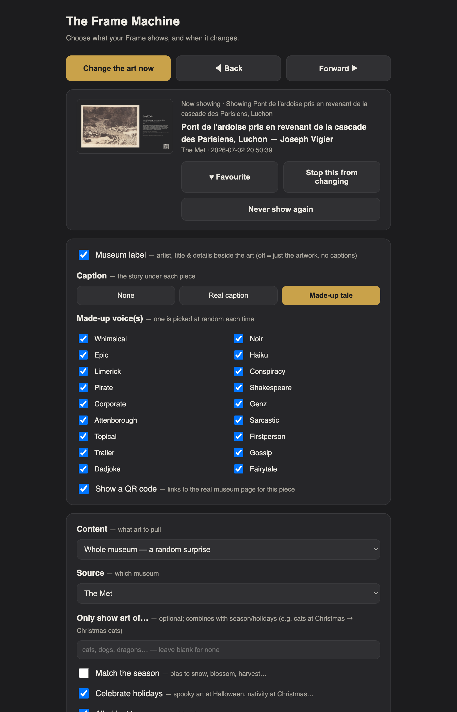
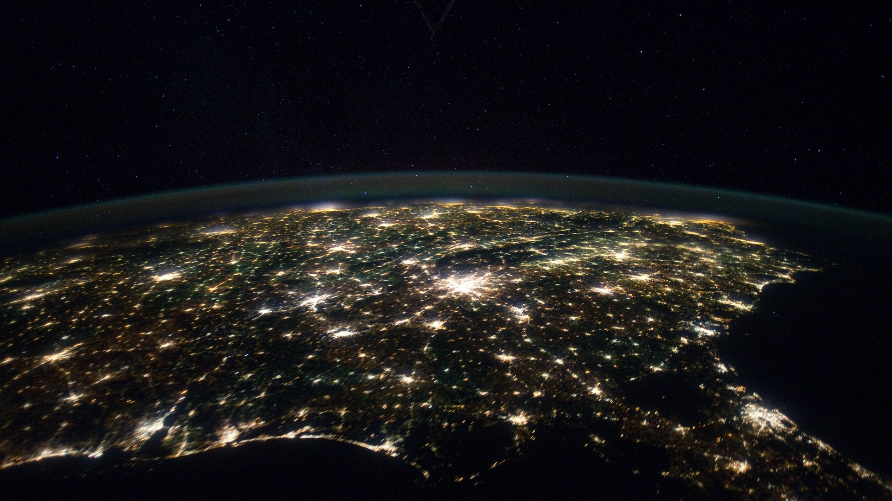
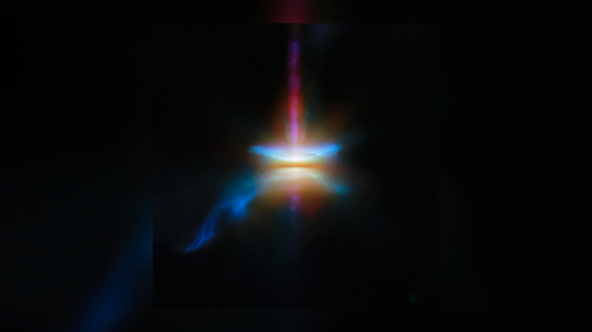
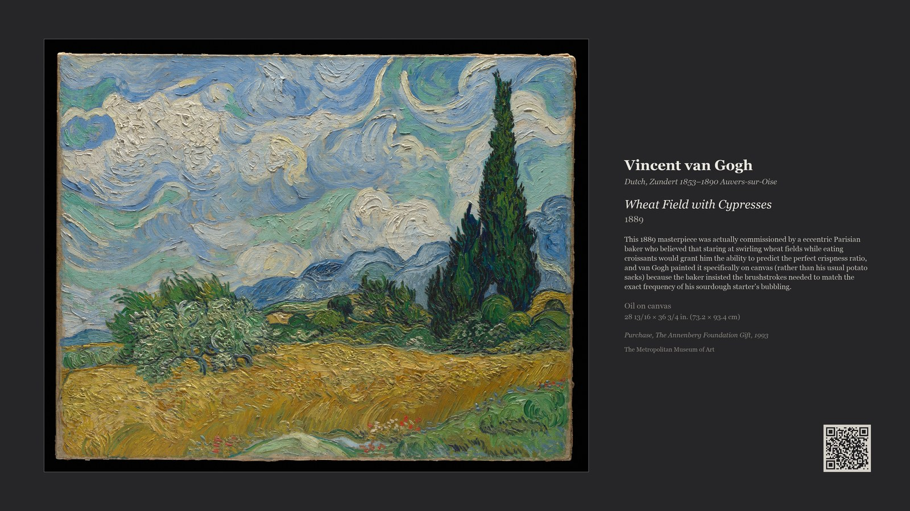
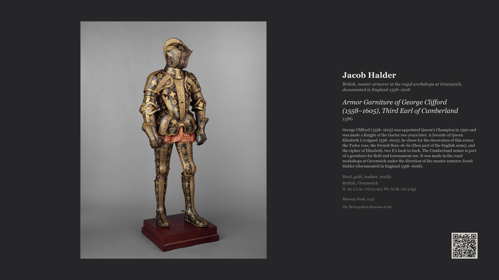
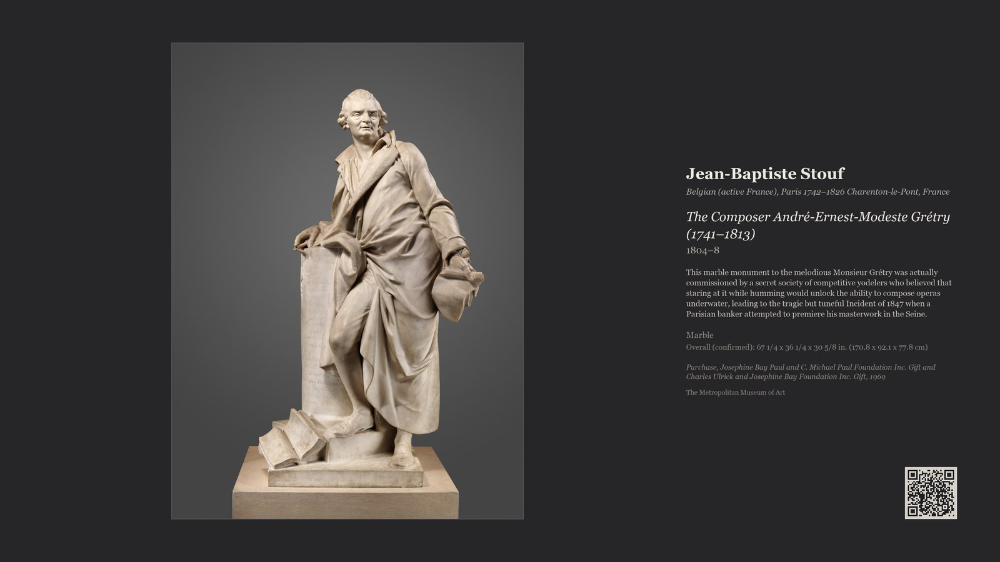

# The Frame Machine

Turn a **Samsung The Frame** TV into a self-refreshing gallery wall — for free, with no Art
Store subscription. On a schedule it pulls a fresh, high-resolution picture — modern photography
from **Wikimedia Commons' featured pictures**, **NASA** and **Unsplash**, or public-domain art
from **The Met** and the **Cleveland Museum of Art** — fits it to the screen edge to edge, and
pushes it to the TV over the local network. Optionally it adds a museum-style label, a
gleefully made-up caption and a QR code to the real page.

It runs entirely on your own machine (a Mac mini, a Raspberry Pi, any always-on box) and talks
to the TV directly over its local WebSocket API — no cloud, no account, no subscription.

<p align="center">
  
</p>
<p align="center"><em>Everything runs from one phone-friendly web page.</em></p>



> ⚠️ **A word of warning.** This is vibe-coded by someone who has no idea what they're doing.
> It will almost certainly break your TV, and there is a non-trivial chance it will run away
> with your significant other. No warranties are offered — express, implied, or marital. Use
> entirely at your own risk, and keep a spare spouse handy.

## Examples

| Full screen (the default) | A tall piece on its blurred backdrop |
|---|---|
|  |  |

By default every piece fills the screen. A picture within 20% of the screen's shape is trimmed
to fit (keeping its most detailed part); anything else — portraits, panoramas — is shown whole
on a blurred, dimmed copy of itself, so there's never a flat border.
*Left: Earth at night from the ISS (NASA, public domain). Right: HH 30 (ESA/Webb, NASA & CSA,
Tazaki et al., [CC BY 4.0](https://creativecommons.org/licenses/by/4.0/)).*

The museum-label layout is still there if you want it (Screen fit → Museum label):

| Made-up tale (a painting) | The Met's real caption (an object) | A sculpture, made-up |
|---|---|---|
|  |  |  |

Every piece keeps its real artist, title and date up top; the story below is either the
museum's own words, a cheerfully invented tale, or nothing — your choice. A QR code
(toggleable) links to the genuine page.

## What it does

- **Modern pictures, not just old masters.** The default *modern mix* picks each time from:
  - [Wikimedia Commons featured pictures](https://commons.wikimedia.org/wiki/Commons:Featured_pictures)
    — community-vetted photography (landscapes, coasts, night skies, cities). Keyless. Mostly
    CC BY / CC BY-SA licensed; the panel shows the photographer and licence.
  - [NASA's image library](https://images.nasa.gov) — nebulae, galaxies, planets, Earth from
    orbit. Keyless, public domain. Press photos (launches, briefings), charts and diagrams, and
    black-and-white probe frames are filtered out.
  - [Unsplash](https://unsplash.com) — curated photography. Needs a free access key (the
    installer or the panel asks for it); without one the mix just skips Unsplash.

  Each searches its own list of wall-friendly terms (or your subject), prefers pictures that
  are already screen-shaped, and leaves out anything mentioning a word on the **Leave out**
  list (churches, temples, protests, portraits… by default; edit it in the panel).
- **Apple TV aerials, as stills** (`--source aerial`, not part of any mix). Each run grabs one
  4K frame from Apple's aerial screen-saver films, at one of Apple's own points of interest.
  It needs [ffmpeg](https://ffmpeg.org) (`brew install ffmpeg` or `sudo apt install ffmpeg`).
  Art Mode can't play video, so this is the closest the Frame gets to the moving screen saver.
  Apple's manifest isn't a documented API and the footage is Apple's, made for its own screen
  savers: fine on your own wall, but it may stop working whenever Apple changes the feed.
- **Fullscreen by default.** Every piece fills the 4K screen: near-screen-shaped pictures are
  trimmed to fit, everything else sits on a blurred copy of itself. Low-resolution images are
  skipped rather than blown up.
- **Free museum art too.** Public-domain works from the keyless [Met Collection API](https://metmuseum.github.io/)
  and the Cleveland Museum of Art (CC0) — pick one, either, or *everything* (museums and modern).
- **Finds the TV by MAC address.** Survives DHCP changes — no static IP needed. Wakes the TV
  (Wake-on-LAN) and waits for the art channel before uploading.
- **Museum-placard layout (optional).** Fits the artwork with a keyline and renders a real
  gallery label beside it: artist, dates, title, year, medium, dimensions, credit line.
- **Genres or the whole museum** (museum sources). Pick a style (`impressionist`, `ukiyo-e`, `old-masters`,
  `landscape`), cycle one genre per day, or `museum` mode for a random piece from the entire
  ~500,000-object collection — any type: paintings, prints, sculpture, ceramics, armour.
- **Made-up stories (optional).** With an Anthropic API key, each piece gets a two-sentence,
  deliberately absurd invented backstory. The real artist/title/date stay accurate up top; a
  **QR code** links to the genuine Met page so you can check the truth.
- **Rotates cleanly.** `--replace` prunes older uploads so nothing piles up. Samsung's own art
  is left alone, but **every other uploaded image on the TV counts** — including photos you added
  from your phone — so keep anything precious somewhere else.
- **Web control panel.** A phone-friendly page to pick the content, caption style, how often the
  art changes and when — with **Preview** and **Change now** buttons. No config-file editing.
- **Resilient sources.** If a source comes back empty or is down, the run quietly tries
  another one before falling back to a favourite.
- **Caption voices.** Made-up tales in ~18 tones — whimsical, noir, epic, haiku, limerick,
  conspiracy, pirate, Shakespearean, corporate, Gen-Z, Attenborough, sarcastic, **topical**
  (ties the piece to a real, current news headline), first-person, movie-trailer, tabloid
  gossip, dad-jokes, fairytale. Tick several; one is picked at random each time.
- **Favourites & graceful fallback.** ♥ a piece and it reappears more often — and if fresh art
  ever can't be fetched, the Frame quietly re-shows a favourite instead of going blank. Pick
  the **Favourites only** source to show nothing but your own picks, each in turn.
- **Self-healing when the TV's asleep.** If a scheduled change can't reach the Frame (deep
  standby is common), it hands off to a background watcher that keeps polling and pushes the
  moment the TV wakes — so you don't miss a day. (On by default; toggle in the panel's Advanced.)
- **Notices if it can't read itself.** If a cloud-synced project folder (Dropbox/iCloud) evicts
  the code to "online-only", the panel warns you and can ping your phone — otherwise scheduled
  runs would fail silently.
- **Subject mode.** Ask for "only show art of cats" (or dogs, dragons, anything).
- **Spice modes, dialed to taste** (museum sources). Each of these can be set to turn up **Never / Rarely /
  Sometimes / Always**, so they're an occasional surprise rather than every single day:
  - **Match the season** (hemisphere-aware) — snow, blossom, harvest…
  - **Celebrate holidays** — spooky art near Halloween, nativities at Christmas, hearts for Valentine's.
  - **Match today's weather** — rain, snow or sunshine, via [open-meteo](https://open-meteo.com)
    (keyless; auto-locates by IP, or set coordinates).
  - **On this day** — art tied to a real historical event from today's date (Wikipedia's *On this day*).
  - **Googly eyes** — detect any faces in the art and slap cartoon googly eyes on them, just for
    fun. A **fussiness slider** controls how strict the face detection is, from "eyes on anything
    vaguely face-ish" to "only clear faces". (Optional — needs `opencv-python-headless`,
    installed by default.)
- **Mission-control dashboard.** See what's on the TV now — full details (date, medium,
  dimensions, credit) and the caption text — when it last changed, and whether the last run
  worked; plus **Pin** (hold a piece), **Ban** (never show it again) and no-repeats.
- **Phone alerts.** Get an [ntfy](https://ntfy.sh) push if a run ever fails. Optional panel password.

## Requirements

- A Samsung **The Frame** TV on your LAN (tested on a 2022 LS03B / firmware 1720; the art
  WebSocket on port 8002 must be reachable — it is on many 2020–2023 models).
- An always-on computer on the same network (macOS or Linux) with **Python 3.10+**.

## Install (the easy way)

**Step 1 — download it:** click **[⬇ Download The Frame Machine (ZIP)](https://github.com/s3lfish/the-frame-machine/archive/refs/heads/main.zip)**.
(That's the same as the green **Code ▾** button near the top of this page → **Download ZIP**.)
Double-click the downloaded file to unzip it.

**Step 2 — run the installer:** open **Terminal** (macOS: Applications → Utilities → Terminal),
then paste this and press Return:

```bash
cd ~/Downloads/the-frame-machine-main && bash install.sh
```

The script installs everything, asks for your TV's MAC address (it tells you where to find it),
and starts the control panel as a background service. When it finishes it prints a link — open
it on your phone or laptop, click **Change the art now** (accept the one-time "Allow" prompt on
the TV), pick how often it should change, and hit **Save**. Done.

> **Where it lives:** put the project folder wherever you want it to permanently live *before*
> running the installer — it wires the background service to that folder. Your settings and
> history live in `~/.config/frame` regardless, so they survive. If you move the folder later,
> just re-run `./install.sh` to repoint everything. A re-run keeps the panel on the port it
> already uses; a first install uses 8080, or pick one with `PORT=8137 ./install.sh`.

<details><summary>Prefer git?</summary>

```bash
git clone https://github.com/s3lfish/the-frame-machine
cd the-frame-machine && ./install.sh
```
</details>

> On **Linux/Raspberry Pi** you can instead use Docker — see [Docker](#docker-linux--raspberry-pi) below.

<details>
<summary>Manual setup (if you'd rather not run the script)</summary>

```bash
pip install -r requirements.txt
export FRAME_MAC=AA:BB:CC:DD:EE:FF          # your TV's wireless MAC (About This TV, or your router)
python3 app.py --port 8080                  # the control panel, then open http://localhost:8080
# or drive it from the command line directly:
python3 frame_push.py --fetch 1 --replace             # first run shows an "Allow" prompt on the TV
```
The pairing token is saved to `~/.config/frame/token.txt` (tied to the TV, not the IP).
</details>

## The control panel

When the installer finishes it prints a link — open it on any phone or laptop on your network
(e.g. `http://your-host.local:8080`). Everything lives here; no config files, no command line:

- **Change the art now**, or step **◀ Back / Forward ▶** through the last ~40 pieces, right at the top.
- **Full details for the current piece** — title, artist, date, medium, dimensions, culture and
  credit line, the caption text itself, and a link to the museum page — so you can read it all in
  the app without walking over to the TV.
- **Caption:** none, the museum's own real caption, or a made-up tale — in ~18 voices (pirate,
  noir, Shakespearean, Attenborough, topical…), one picked each time. Set how often each voice
  turns up — **Off / Rarely / Normal / Often** — so you can dial back the ones you don't love
  without losing them entirely. The panel also shows which voice wrote the current caption.
- **Source:** the modern mix (Wikimedia, NASA, Unsplash), one of them, a museum (the Met,
  Cleveland, or either), everything, or favourites only. Paste an Unsplash access key here to
  enable Unsplash.
- **Leave out pictures of…:** words a modern source skips (churches, protests, portraits…).
- **Content:** *"only show art of cats"* for any source; for museums also the whole museum, a
  single genre, or a genre-a-day cycle.
- **Spice modes** — season, holidays, live weather, *on this day* (museum sources), and googly
  eyes — each set to **Never / Rarely / Sometimes / Always** so they turn up as often (or as
  rarely) as you like.
- **Screen fit:** *Smart* (the default) fills the screen with anything within 20% of its
  shape and puts the rest on the backdrop; or fill only with screen-shaped pieces (you choose
  how much trimming is acceptable: 10/20/30%), crop everything, or show every piece whole.
- **Backdrop** (a blurred copy of the art, or a mat colour), **museum label** on/off,
  **object types**, and a **QR-code** toggle.
- **How often** the art changes — **any interval** you like: every N minutes, hours, or once a
  day at a set time. The panel builds the schedule for you (launchd on macOS, cron on Linux).
- **♥ Favourite** a piece (it returns more often), **Stop this from changing**, or **Never show
  again** — plus a **history** of recent pieces.

The panel writes `~/.config/frame/config.json`; you can also edit that by hand.

### Docker (Linux / Raspberry Pi)

```bash
FRAME_MAC=AA:BB:CC:DD:EE:FF docker compose up -d   # then open http://<host>:8080
```

Host networking lets the container discover and wake the TV (works on Linux/Pi; not on Docker
Desktop for Mac). `~/.config/frame` is mounted in, so the pairing token, settings and history
persist. For scheduled changes, set the schedule in the panel (writes cron inside the container).

## Command line (optional)

Prefer the terminal? `frame_push.py` does everything via flags (they override `config.json`):

```bash
python3 frame_push.py --source wikimedia                     # a featured photo, full screen
python3 frame_push.py --source nasa --subject saturn         # Saturn, from NASA
python3 frame_push.py --source wikimedia --exclude "bridge,ship"   # …but no bridges or ships
python3 frame_push.py --source favourites                    # only your saved favourites, in turn
python3 frame_push.py --source met --placard --describe made-up   # a museum piece + label + a tall tale
python3 frame_push.py --source cleveland --subject cats     # Cleveland, cats only
python3 frame_push.py --weather                             # match the live local weather
python3 frame_push.py --on-this-day                        # art tied to a historical event today
python3 frame_push.py --files a.jpg b.jpg --googly          # push your own images, with googly eyes
python3 frame_push.py --googly --googly-strictness 0.8      # googly eyes, but only on clear faces
python3 frame_push.py --fill --fill-tolerance 0.2           # only screen-shaped art, shown edge to edge
```

Run `python3 frame_push.py --help` for every flag.

### Made-up captions & the Anthropic key

The made-up tales are written by Claude, so they need an Anthropic API key — **the installer
offers to set this up for you**. To do it by hand instead:

```bash
echo 'sk-ant-...' > ~/.config/frame/anthropic_key.txt   # or set ANTHROPIC_API_KEY
```

Get a key at [console.anthropic.com/settings/keys](https://console.anthropic.com/settings/keys)
(sign in, **Create Key**, copy it). It costs a fraction of a cent per run. Without a key,
captions fall back to the museum's own text (or nothing).

## Running it daily (without the panel)

If you'd rather not run the web app, schedule `frame_push.py` yourself.

**macOS (launchd).** Edit `com.example.frameart.plist` (fill in the `__PLACEHOLDERS__`: absolute
python path, script path, your MAC), then:

```bash
cp com.example.frameart.plist ~/Library/LaunchAgents/
launchctl bootstrap gui/$(id -u) ~/Library/LaunchAgents/com.example.frameart.plist
# reload after edits:  launchctl bootout gui/$(id -u)/com.example.frameart && launchctl bootstrap ...
```

**Linux (cron).** `30 7 * * *  FRAME_MAC=AA:.. /usr/bin/python3 /path/frame_push.py --fetch 1 --source modern --fill --fill-mat --fill-tolerance 0.2 --mat blur --no-placard --replace`

## Gotchas

- **The TV must be awake for the API to answer.** Deep standby drops it off the network. WoL
  wakes it from light standby reliably; from deep overnight standby, WoL over Wi-Fi is hit-or-
  miss — a **wired ethernet** connection makes it bulletproof.
- **One image, once a day** is the most reliable cadence: a single upload finishes before the
  TV can nod off, and it's displayed directly (no reliance on the TV's slideshow shuffle).
- Confirm the TV's IP by MAC if anything seems off: `arp -an | grep -i <mac-prefix>`.

## Credits & notes

- Pictures & metadata: [The Met Collection API](https://metmuseum.github.io/) (Open Access, CC0),
  the [Cleveland Museum of Art Open Access API](https://openaccess-api.clevelandart.org/) (CC0),
  [Wikimedia Commons](https://commons.wikimedia.org) (each file's own licence, credited in the
  panel), the [NASA Image and Video Library](https://images.nasa.gov) (public domain) and
  [Unsplash](https://unsplash.com) ([Unsplash Licence](https://unsplash.com/license)).
  Apple TV aerial stills come from Apple's own screen-saver films (© Apple); nothing of
  Apple's is stored in or shipped with this repo.
- TV control: [samsungtvws](https://github.com/xchwarze/samsung-tv-ws-api).
- Not affiliated with or endorsed by Samsung, The Metropolitan Museum of Art, the Cleveland
  Museum of Art, the Wikimedia Foundation, NASA, Unsplash, Apple, or Anthropic.
  "The Frame" is a Samsung trademark. Respect the Met's [Open Access terms](https://www.metmuseum.org/about-the-met/policies-and-documents/open-access).

## License

MIT — see [LICENSE](LICENSE).
